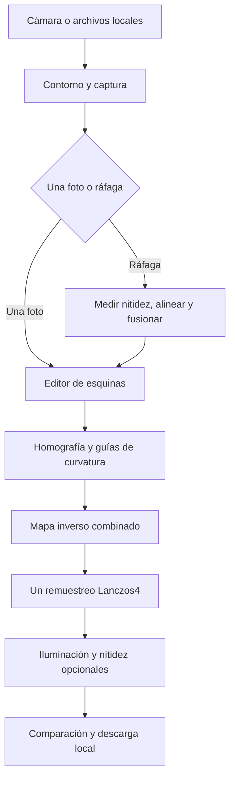

# Web Document Scanner

Escáner de documentos que funciona en el navegador. Detecta el contorno de la hoja en la cámara, combina una ráfaga de fotos y corrige perspectiva, curvatura e iluminación antes de exportar la imagen.

**[Usar el escáner](https://gdluka.github.io/web-document-scanner/)** · **[Abrir en StackBlitz](https://stackblitz.com/github/gdluka/web-document-scanner?startScript=dev)** · **[Código fuente](https://github.com/gdluka/web-document-scanner)**

Las fotografías se procesan en el dispositivo. La aplicación no tiene servidor de documentos, cuentas de usuario, telemetría ni servicios de OCR conectados.

## Qué incluye

- Cámara posterior con detección de bordes en vivo y contorno superpuesto al vídeo.
- Captura de seis fotografías y carga manual de entre dos y ocho imágenes.
- Selección de la captura más nítida y fusión de las imágenes que se pueden alinear con confianza.
- Detección automática y ajuste manual de las cuatro esquinas, con controles táctiles y de teclado.
- Corrección de perspectiva y corrección experimental de la curvatura de tablas.
- Remuestreo geométrico único desde la imagen original, con interpolación Lanczos4.
- Perfiles para tablas, documentos y fotografías; compensación de iluminación y nitidez suave.
- Comparación entre original, ráfaga, perspectiva preparada y resultado.
- Exportación PNG, JPEG y WebP.
- Descarga local de los metadatos geométricos y de procesamiento.
- Funcionamiento offline en la versión compilada, después de descargar los motores.

## Usar la web pública

Abrir **[Usar el escáner](https://gdluka.github.io/web-document-scanner/)** para ejecutar la versión compilada en una pestaña normal, incluyendo desde el teléfono. Está alojada en GitHub Pages mediante HTTPS. El sitio entrega archivos estáticos; las fotos se procesan en el dispositivo.

La publicación se realiza automáticamente desde `main` después de pasar las pruebas. StackBlitz sigue disponible para editar y ejecutar el proyecto en su entorno de desarrollo.

## Probar en StackBlitz

1. Abrir el enlace **Abrir en StackBlitz**.
2. Esperar a que se instalen las dependencias y arranque `npm run dev`.
3. Abrir la vista previa en una pestaña independiente mediante **Open in new tab**.
4. Permitir el acceso a la cámara cuando lo solicite el navegador.
5. Pulsar **Abrir cámara para ráfaga** y encuadrar la hoja completa.

StackBlitz importa directamente el repositorio público. No requiere configurar credenciales de la aplicación. Su entorno WebContainers ejecuta el servidor de desarrollo en el navegador: la disponibilidad y el consumo de memoria dependen del navegador y del dispositivo. La vista previa puede necesitar una pestaña independiente para solicitar acceso a la cámara.

El modo offline de esta aplicación se habilita en una compilación de producción. En StackBlitz se utiliza la vista previa de desarrollo, cuyo entorno gestiona sus propios recursos. No se promete funcionamiento offline de StackBlitz.

Referencias oficiales: [importación desde GitHub](https://developer.stackblitz.com/guides/user-guide/importing-projects) y [compatibilidad de navegadores](https://developer.stackblitz.com/platform/webcontainers/browser-support).

## Cómo escanear

### Captura con cámara

1. Colocar el documento sobre una superficie que contraste con el papel.
2. Evitar sombras fuertes, reflejos y movimientos durante la captura.
3. Abrir la cámara y esperar a ver el contorno verde sobre la hoja.
4. Revisar que incluya sus cuatro bordes y pulsar **Capturar 6 fotos**.
5. Esperar a que se seleccione la mejor foto y se combine la ráfaga.
6. Revisar las esquinas y ajustarlas si fuera necesario.
7. Confirmar los bordes. La ráfaga se recorta, endereza y procesa automáticamente.
8. Comparar los resultados y descargar la variante más legible.

El contorno representa una detección real. Si el detector no encuentra una hoja, se muestra el estado de búsqueda; no se simula una detección. Después de capturar, siempre se puede ajustar el encuadre manualmente.

### Fotografía o ráfaga existente

**Cargar fotografía** abre una imagen desde el dispositivo. **Tomar foto** utiliza la cámara del sistema operativo; el contorno en vivo pertenece a **Abrir cámara para ráfaga**, no a la interfaz de cámara del sistema.

**Cargar fotos de una ráfaga** admite de dos a ocho imágenes de la misma hoja, con la misma orientación y resolución. Conviene utilizar los archivos originales, sin compresión de aplicaciones de mensajería.

Al cargar una sola foto se confirma primero el recorte y luego se pulsa **Procesar imagen**. **Usar original** conserva la fotografía completa. **Cancelar foto** sale del editor sin sustituir la última imagen preparada.

### Ajuste de esquinas y opciones

Los puntos se pueden arrastrar con el dedo o el ratón. Con un punto enfocado, las flechas del teclado permiten ajustes pequeños. Se rechazan esquinas cruzadas, fuera de la imagen o que forman un área demasiado pequeña.

- **Girar 90°** modifica la orientación y vuelve a detectar los bordes.
- **Detectar bordes** repite la detección automática.
- **Recorte rectangular** permite seleccionar una zona sin perspectiva.
- **Corregir curvatura de la tabla** activa el modo experimental basado en líneas físicas.
- **Compensar sombras e iluminación** busca uniformar el fondo del papel.
- **Nitidez suave** aplica un refuerzo moderado; valores altos pueden exagerar halos.
- **Enderezar filas con líneas fiables** es una alternativa para tablas con líneas inclinadas. Se deshabilita si ya se aplicó la corrección de curvatura, para evitar otra transformación innecesaria.
- **PNG** conserva los píxeles sin compresión con pérdida. JPEG y WebP permiten ajustar calidad.

Comparar siempre códigos pequeños, signos y cifras. Una imagen que parece más contrastada puede perder detalles útiles para OCR.

## Ejecutar localmente

Requiere Node.js **22.12 o posterior**. Se puede usar npm o pnpm.

```bash
git clone https://github.com/gdluka/web-document-scanner.git
cd web-document-scanner
npm install
npm run dev
```

Vite informa la dirección local. Para acceder a la cámara se necesita un contexto seguro: HTTPS o `localhost`. Acceder desde el teléfono a una dirección HTTP de la red local no garantiza permiso para usar la cámara; se debe utilizar una vista previa HTTPS o un túnel HTTPS.

```bash
npm test
npm run typecheck
npm run build
npm run preview
```

Para ejecutar las pruebas de navegador, instalar Chromium con `npx playwright install chromium` y usar `npm run test:e2e`.

El resultado de `npm run build` queda en `dist/` y se puede servir en cualquier alojamiento estático HTTPS. No necesita una base de datos ni un servidor Node.js en producción.

Para alojarlo bajo una subcarpeta, definir `SCANNER_BASE` al compilar:

```bash
SCANNER_BASE=/web-document-scanner/ npm run build
```

Los workers y los motores utilizan la misma base. La importación en StackBlitz usa `/` de forma predeterminada.

## Arquitectura



La interfaz utiliza **SolidJS y TypeScript**, con **Vite** para desarrollo y compilación. Las operaciones costosas de fusión y procesamiento se ejecutan en **Web Workers** para permitir que la interfaz siga respondiendo.

Los motores son recursos locales del proyecto:

- [`101arrowz/scanner`](https://github.com/101arrowz/scanner): detección de bordes en WebAssembly.
- [OpenCV.js](https://github.com/opencv/opencv/tree/4.12.0): transformaciones, morfología, filtros y remuestreo.
- [Distribución OpenCV.js](https://github.com/TechStark/opencv-js): versión fijada `4.12.0-release.1`.

No se descarga código de motores desde un CDN durante el escaneo. En la primera visita el navegador descarga los archivos públicos del proyecto, incluyendo OpenCV.js, cuyo archivo ocupa aproximadamente 11 MB. El tiempo inicial incluye esa descarga y la inicialización de WebAssembly.

## Proceso técnico

### 1. Vista previa y detección del contorno

La cámara solicita orientación posterior y una resolución ideal de 2560 × 1920. El navegador y el dispositivo deciden la resolución disponible.

La detección en vivo analiza un cuadro reducido cuyo lado mayor no supera 640 píxeles. Cada análisis termina antes de programar el siguiente, con una pausa de 700 ms. Este intervalo no equivale a una tasa fija de cuadros por segundo: también depende del tiempo de detección.

Las esquinas se normalizan a coordenadas `[0, 1]`. El SVG y el vídeo comparten contenedor, dimensiones y coordenadas. La posición del contorno se define dentro del componente para que no quede debajo del vídeo si la hoja de estilos es anterior.

Cerrar o cancelar la cámara detiene todas sus pistas y descarta los resultados de detecciones anteriores. Durante la captura se evita iniciar otro análisis del cuadro.

### 2. Captura y fusión de ráfaga

Cuando está disponible, se utiliza `ImageCapture.takePhoto()` para obtener fotografías. Si no se puede usar, se extraen cuadros de la transmisión de vídeo. Se capturan seis imágenes, con pausas de 180 ms entre solicitudes; las capturas de alta resolución pueden agregar su propia demora.

Las imágenes se reducen, si es necesario, a un lado mayor de 2000 píxeles. Se evalúa su nitidez, se selecciona una referencia y se alinean las demás por desplazamiento X/Y con refinamiento subpíxel. La alineación actual no estima giros, cambios de escala ni deformaciones locales. Las imágenes con alineación insuficiente se descartan. Si solamente una es fiable, se conserva la mejor captura y se informa ese resultado.

La fusión busca reducir ruido y mejorar legibilidad. Esta implementación **no es superresolución** y no promete recuperar detalle que ninguna captura contiene. Un movimiento grande, desenfoque, cambios de iluminación u objetos móviles pueden impedir una combinación útil.

### 3. Perspectiva

El editor trabaja con cuatro puntos en orden horario: inferior izquierdo, superior izquierdo, superior derecho e inferior derecho. Se validan límites, convexidad y un área normalizada mínima del 2 %.

A partir de las esquinas se calcula una homografía que transforma el cuadrilátero de la hoja en un rectángulo. El tamaño de trabajo se limita para controlar memoria y tiempo de procesamiento. El editor prepara la imagen a un lado mayor de 2400 píxeles y permite una ampliación geométrica acotada; ampliar no crea detalle óptico nuevo.

### 4. Detección de guías y ajuste cúbico

Para analizar la curvatura se construye una vista rectificada de referencia. Esa vista solamente sirve para detectar geometría: el resultado final se remuestrea desde la imagen fuente.

El detector utiliza gris, umbral adaptativo y apertura morfológica horizontal para buscar líneas físicas de la tabla. Muestrea 45 posiciones del eje X, entre el 4,5 % y el 96,5 % del ancho. Las trayectorias deben cubrir una proporción suficiente de esas posiciones; los fragmentos cortos de texto no se aceptan como guías fiables.

Cada guía se aproxima por un polinomio:

```text
u = x / W
s_i(x) = a0 + a1·u + a2·u² + a3·u³
```

Normalizar X mejora el condicionamiento numérico. Los cuatro coeficientes se obtienen mediante mínimos cuadrados con **QR y Gram–Schmidt modificado, con dos pasadas de ortogonalización**. El cálculo está implementado en TypeScript y no necesita NumPy, una biblioteca de álgebra adicional ni un modelo de IA.

Se controlan cobertura, residuo, posición y separación entre guías. Su cantidad depende de cada documento; no se asume un número fijo de filas.

### 5. Interpolación vertical entre curvas

Para cada guía se define una altura de destino estable `t_i`, tomando su altura en el centro de la tabla. Se agregan anclas para el borde superior y el inferior de la imagen.

Para una fila de salida `y` entre dos anclas consecutivas:

```text
alpha = (y - t_i) / (t_(i+1) - t_i)
Y_curva(x,y) = (1-alpha)·s_i(x) + alpha·s_(i+1)(x)
```

La interpolación entre guías es **lineal por tramos**. Los polinomios cúbicos describen la curvatura horizontal de cada guía; no se ajusta otro polinomio global a todas las filas.

### 6. Mapa combinado y remuestreo único

La coordenada `(x, Y_curva)` se transforma mediante la homografía inversa hacia la imagen fuente. Así se obtiene un mapa que compone perspectiva y curvatura antes de interpolar los píxeles:

```text
source(x,y) = H_inverse(x, Y_curva(x,y))
output = remap(original, source, Lanczos4)
```

Esto evita aplicar primero una transformación de perspectiva al resultado final y luego volver a interpolarlo para corregir la curvatura. La interpolación Lanczos4 se realiza una sola vez en la etapa geométrica. Los filtros de imagen posteriores siguen siendo opcionales.

Los mapas X e Y son `Float32Array` planos. Se precalculan las posiciones de las guías y se recorre la salida por filas para mejorar la localidad de memoria. El bucle por píxel no crea objetos pequeños ni arreglos temporales.

### 7. Validación y fallback

Antes de remuestrear, se validan todas las columnas, incluyendo `x = 0` y `x = W - 1`. Esto cubre los márgenes en los que los polinomios extrapolan fuera de su región de muestreo.

Se comprueban orden vertical, separación positiva y escala local acotada. Se rechazan cruces, compresión excesiva, denominadores de homografía inválidos y coordenadas no finitas. Si faltan guías suficientes o falla la validación, se aplica **solamente perspectiva** y se informa que la curvatura no se corrigió.

Los objetos `cv.Mat` se liberan en bloques `finally`. Los workers se terminan después de completar, cancelar o fallar una operación.

### 8. Iluminación y nitidez

Los filtros operan después de la preparación geométrica. La compensación de iluminación estima el fondo para reducir variaciones de luz; la nitidez agrega un refuerzo moderado de contraste local. El umbral adaptativo se usa para detectar guías geométricas; la imagen exportada no recibe una binarización adaptativa final para OCR.

Estos filtros no deshacen de forma general el desenfoque ni reconstruyen letras perdidas. Cuando el original ya es nítido, la corrección geométrica sin filtros adicionales puede producir la mejor imagen para OCR. Conviene comparar varias variantes y elegir la que conserva mejor las cifras.

## Metadatos e integración con OCR

**Descargar metadatos** genera un JSON local con dimensiones, rotación, esquinas, homografía, curvas, alturas de destino, fallback, opciones y medidas de procesamiento. No incluye el contenido de la fotografía ni reconoce nombres o cifras.

Este proyecto prepara imágenes. **El reconocimiento de texto no está incluido en la interfaz pública.** No contiene claves de proveedores ni utiliza una cuenta compartida de OCR. Se puede enviar la imagen descargada a un motor de OCR propio o integrar uno en una aplicación que use estos módulos.

Para integrar resultados de OCR basados en coordenadas:

1. Registrar las dimensiones de la imagen efectivamente enviada al OCR.
2. Si se redujo desde una altura `H` a `H_ocr`, escalar cada guía con `k = H_ocr / H`.
3. Comparar las cajas del texto con intervalos entre guías escaladas, sin confiar en el orden de un arreglo de palabras.
4. Distinguir encabezados por semántica y estructura antes de aplicar reglas comerciales a filas de datos.
5. Definir columnas usando encabezados y alineaciones repetidas de los datos; una guía horizontal no delimita columnas por sí sola.
6. Marcar asociaciones ambiguas para revisión, en lugar de asignar precios automáticamente.

Las guías de este proyecto describen líneas geométricas. Su presencia no garantiza que cada intervalo sea un artículo ni que el OCR reconozca el 100 % de una imagen. La lógica de documentos, columnas y validación comercial pertenece a la integración que consuma la imagen.

## Investigación de técnicas para mejorar el OCR

Revisión del **11 de octubre de 2026**. Se compararon repositorios y documentación primaria con la implementación de este proyecto. Las técnicas siguientes son propuestas de evaluación: **no están integradas ni se midió una mejora de reconocimiento con ellas**. El escáner público sigue preparando imágenes sin ejecutar OCR.

### Proyectos y diferencias concretas

| Proyecto y fuente | Técnica que aporta | Diferencia y posible aplicación |
| --- | --- | --- |
| [OSS Document Scanner](https://github.com/ossappscollective/OSS-DocumentScanner/blob/main/plugin-nativeprocessor/platforms/android/java/com/akylas/documentscanner/AutoScanHandler.kt) | Sigue las cuatro esquinas entre cuadros y cancela la captura automática cuando pierde la continuidad del contorno. | Actualmente el usuario dispara la ráfaga sin una comprobación temporal de estabilidad. Adaptar esa idea a coordenadas normalizadas y agregar, como propuesta propia, control de nitidez dentro de la hoja y de zonas sobreexpuestas. Su implementación es nativa; se adaptaría la técnica a TypeScript. |
| [page-dewarp](https://github.com/lmmx/page-dewarp), [explicación del autor original](https://mzucker.github.io/2016/08/15/page-dewarping.html) | Agrupa contornos de texto en renglones y ajusta un modelo de superficie cúbica mediante optimización. | Nuestro ajuste depende de líneas físicas de tablas. Usar líneas de texto como guías adicionales permitiría evaluar documentos sin cuadrícula. El modelo Python no es un reemplazo directo del worker; hay que medir el costo de optimización. El autor también documenta compresión horizontal residual. |
| [ScanTailor Advanced](https://github.com/ScanTailor-Advanced/scantailor-advanced) | Binarización adaptativa Sauvola/Wolf y separación del contenido de texto e imágenes. | Compensamos el fondo, pero no generamos una variante final con umbral local. Probar Sauvola después de la geometría, conservando también una versión en gris; medir si mantiene cifras finas. Es una referencia de algoritmos, no una dependencia de navegador. |
| [Deep Burst Super-Resolution](https://github.com/goutamgmb/deep-burst-sr) | Alineación mediante flujo óptico por píxel y fusión aprendida de múltiples capturas RAW para superresolución. | Nuestra fusión usa desplazamiento global y promedio con rechazo de diferencias. Primero probar alineación afín y pesos locales de nitidez; solamente después evaluar flujo óptico. El modelo RAW no se puede aplicar directamente a nuestra ráfaga JPEG/PNG esperando los mismos resultados. |
| [PaddleOCR.js, SDK oficial](https://github.com/PaddlePaddle/PaddleOCR/blob/main/paddleocr-js/packages/core/README.md) | Detecta y reconoce texto en el navegador; devuelve polígonos, texto y puntuación. Admite un worker dedicado y configuración del runtime WASM. | Permite evaluar OCR local como módulo opcional. Elegir modelos adecuados al idioma y medir descarga, memoria, tiempo y exactitud en teléfonos reales. El OCR de navegador no implica que todos los módulos Python de PaddleOCR estén disponibles en JavaScript. |
| [UVDoc](https://github.com/tanguymagne/UVDoc), [preprocesador de PaddleOCR](https://www.paddleocr.ai/main/en/version3.x/pipeline_usage/doc_preprocessor.html) | Estima una malla de deformación del documento con un modelo entrenado; PaddleOCR ofrece UVDoc como módulo opcional de rectificación. | Evaluar una corrección geométrica más general que nuestra interpolación vertical entre guías. Empezar con la implementación Python en laboratorio; la disponibilidad de PaddleOCR.js no confirma soporte de UVDoc en ese SDK. |
| [Tesseract.js](https://github.com/naptha/tesseract.js), [guía oficial de calidad de Tesseract](https://tesseract-ocr.github.io/tessdoc/ImproveQuality.html) | OCR en navegador mediante WASM; la guía describe Sauvola/Otsu adaptativo, segmentación por región y configuración para códigos o cifras. | Probar reconocimiento por celdas o columnas con modos de línea/palabra y restricciones de caracteres específicas del campo. Una restricción numérica debe aplicarse a precios, conservando letras en códigos y descripciones. La documentación advierte que las tablas requieren análisis de layout. |
| [Scribe.js](https://github.com/scribeocr/scribe.js), [comparación con Tesseract.js](https://github.com/scribeocr/scribe.js/blob/master/docs/scribe_vs_tesseract.md) | Su modo de calidad agrega reconocimiento y comprobaciones; también extrae texto existente de PDFs. | Referencia para evaluar una segunda lectura de campos ambiguos. Sus autores indican más consumo y tiempo; se debe comprobar la mejora con documentos propios. Usa AGPL-3.0 y no se incorporó al proyecto MIT. |
| [DocRes](https://github.com/ZZZHANG-jx/DocRes) | Restauración aprendida con tareas de rectificación, eliminación de sombras, desenfoque y binarización. | Evaluar por separado los casos en que la geometría ya está resuelta y todavía falta legibilidad. Su implementación Python y sus pesos requieren una prueba de laboratorio; la apariencia mejorada no demuestra que conserve correctamente letras y números. |

### Orden recomendado de experimentos

Este orden es una conclusión de la comparación, no un resultado de rendimiento ya demostrado:

1. **Captura:** medir nitidez dentro del documento, estabilidad del contorno y saturación antes de iniciar la ráfaga. La medición actual de nitidez usa toda la foto y puede verse influida por objetos del fondo. Mantener captura manual cuando la evaluación sea incierta.
2. **Filtros para OCR:** comparar perspectiva/curvatura sin filtros, gris con iluminación compensada y Sauvola. Ajustar el tamaño de ventana según la escala del texto; conservar siempre el original. No aplicar erosión, dilatación o refuerzo agresivo de nitidez por defecto.
3. **Ráfaga:** ensayar una transformación afín antes del flujo óptico denso. OpenCV documenta [alineación ECC con modelos de traslación, euclídeo, afín y homografía](https://docs.opencv.org/4.12.0/dc/d6b/group__video__track.html); verificar si la distribución de OpenCV.js utilizada exporta las funciones necesarias. Rechazar alineaciones dudosas y comparar la fusión con la mejor captura individual.
4. **Reconocimiento:** comparar el mismo motor OCR sobre las variantes de imagen; después comparar Tesseract.js y PaddleOCR.js sobre una misma variante. Usar una segunda lectura solamente para regiones ambiguas y registrar desacuerdos.
5. **Geometría difícil:** añadir guías de texto y evaluar UVDoc/DocRes en laboratorio cuando el caso no se resuelva con los pasos anteriores. Conservar las validaciones del mapa y componer las transformaciones antes del remuestreo final.

### Cómo decidir si una técnica mejora el resultado

Preparar un conjunto fijo de documentos autorizados con transcripción de referencia, incluyendo poca luz, movimiento, pliegues y texto pequeño. Ejecutar comparaciones con idéntico motor, versión, idioma y configuración de OCR, cambiando una etapa por vez.

Registrar error por carácter (CER), porcentaje de códigos e importes exactos, asociación correcta entre fila y precio, omisiones, falsos positivos, tiempo, memoria y tamaño de descarga. Un importe legible asignado a otra fila sigue siendo un error. Priorizar conservación de caracteres y menor cantidad de asociaciones incorrectas; revisar por separado resultados visuales y resultados OCR.

Las fotografías y las transcripciones de referencia permanecen fuera del repositorio público. Esta revisión no promete reconocimiento completo ni una mejora porcentual sin ejecutar esos experimentos.

## Uso offline

En una versión compilada y servida por HTTPS:

1. Abrir la aplicación con conexión.
2. Esperar a que se active su service worker.
3. Pulsar **Preparar para usar sin conexión**.
4. Esperar la confirmación de que se descargaron todos los motores.
5. Volver a abrirla sin conexión y cargar una fotografía local o usar la cámara, si el navegador lo permite.

El caché guarda la aplicación y sus motores, no las fotografías del usuario. Las actualizaciones cambian la versión del caché. Los navegadores pueden borrar datos temporales cuando falta espacio; el modo offline debe comprobarse en el dispositivo de uso.

## Privacidad y publicación

El repositorio contiene código, motores, licencias, configuración y pruebas con datos sintéticos. No contiene fotografías de usuarios, documentos comerciales, reportes de OCR reales, credenciales, bases de datos ni variables privadas.

La aplicación no envía fotografías al servidor. Descargar un archivo guarda una copia en el dispositivo; compartirla después queda a decisión del usuario. La cámara requiere permiso explícito del navegador y se detiene al cerrarla o abandonar el componente.

El alojamiento público y StackBlitz entregan los archivos de la aplicación y las dependencias; se aplican sus propias condiciones de servicio. El escáner no agrega analítica ni recolección de documentos.

## Estructura del código

| Archivo | Responsabilidad |
| --- | --- |
| `src/shared/document-scanner/DocumentScannerApp.tsx` | Interfaz y comparación de resultados. |
| `src/shared/document-scanner/BurstDocumentCapture.tsx` | Cámara, contorno en vivo y captura de ráfaga. |
| `src/shared/ui/DocumentImageEditor.tsx` | Esquinas, rotación y preparación geométrica. |
| `src/app/documentScanner.client.ts` | Detector y solicitudes de perspectiva al worker. |
| `src/shared/document-scanner/burst.ts` | Nitidez, alineación y fusión de capturas. |
| `src/shared/document-scanner/burst.worker.ts` | Ejecución de la fusión en segundo plano. |
| `src/shared/document-scanner/curvedTableGeometry.ts` | Ajuste QR, curvas y mapa inverso combinado. |
| `src/shared/document-scanner/tableGeometry.ts` | Corrección alternativa de líneas inclinadas. |
| `src/shared/document-scanner/scanner.worker.ts` | OpenCV, perspectiva, curvatura y filtros. |
| `src/shared/document-scanner/scanner.client.ts` | Preparación de imágenes, opciones y exportación. |
| `src/shared/document-scanner/scannerSession.ts` | Tipos de metadatos geométricos. |
| `src/app/scannerAssets.ts` | Rutas compatibles con alojamientos en subcarpetas. |
| `public/vendor/` | Motores distribuidos localmente y sus licencias. |
| `scripts/build-offline.mjs` | Versión del caché y recursos de producción. |

## Pruebas y límites

La validación inicial pasó **17 pruebas unitarias y 3 pruebas de navegador**, además de la comprobación de tipos y la compilación de producción. Todas las imágenes de prueba son sintéticas.

Las pruebas unitarias utilizan datos sintéticos para verificar validación de esquinas, nitidez y fusión, ajuste cúbico, orden de curvas, mapas y fallback. Las pruebas de navegador verifican superposición del contorno, anchuras móviles, exportación, funcionamiento de los motores y modo offline.

La duración depende de la resolución, el número de imágenes, la primera carga de WebAssembly y el dispositivo. El tiempo mostrado junto al resultado corresponde a la etapa de filtros; no representa el tiempo completo desde la apertura de cámara hasta la descarga.

Una tabla con líneas visibles puede rectificarse mejor que una página sin guías. Arrugas, pliegues bruscos, superficies no desarrollables, sombras intensas y desenfoque fuerte pueden impedir corregir la curvatura. Esta función es experimental y conserva un fallback explícito.

La compatibilidad de cámara, `ImageCapture`, WebAssembly, memoria y formatos de exportación depende del navegador. Cuando la cámara no está disponible, se pueden cargar fotografías existentes.

No se garantiza reconocimiento perfecto, aumento real de resolución ni corrección general de cualquier deformación del papel.

## Licencias y atribuciones

El código propio se publica bajo [licencia MIT](LICENSE).

- `101arrowz/scanner`: MIT; atribución y licencia en [`public/vendor/document-scanner/LICENSE`](public/vendor/document-scanner/LICENSE).
- OpenCV: Apache 2.0; licencia en [`public/vendor/opencv/LICENSE`](public/vendor/opencv/LICENSE).
- Distribución de OpenCV.js: licencia y procedencia en [`DISTRIBUTION-LICENSE`](public/vendor/opencv/DISTRIBUTION-LICENSE) y [`SOURCE.txt`](public/vendor/opencv/SOURCE.txt).

La distribución de OpenCV.js incorpora dos adaptaciones de Emscripten para utilizar cierres estáticos en lugar de constructores dinámicos `Function`. Se conservan sus avisos de licencia y se documenta esa modificación en `SOURCE.txt`.
